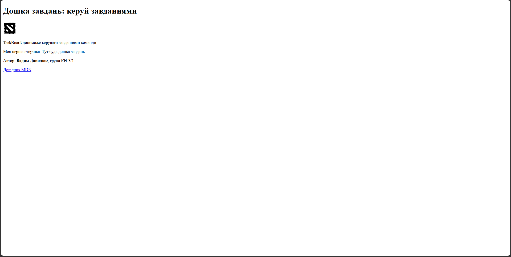

# TaskBoard
Дошка завдань: навчальний наскрізний проєкт з дисципліни «Технології створення веб-застосунків».

## Автор
- Ім'я: Вадим Давидюк
- Група: КН-3/1

## Про проєкт
TaskBoard дозволяє створювати завдання, ставити їм статуси й відстежувати виконання. Проєкт розвивається поетапно протягом курсу.

## Технології
| Шар | Технології |
|---|---|
| Frontend | HTML, CSS, JavaScript |
| Backend | Python, Flask *(буде додано)* |
| База даних | SQLAlchemy, PostgreSQL *(буде додано)* |
| Розгортання | Docker *(буде додано)* |

## План розвитку
- [x] Репозиторій і перша сторінка
- [ ] Адаптивна верстка (HTML + CSS)
- [ ] Інтерактивність (JavaScript)
- [ ] Серверна частина на Flask
- [ ] База даних та користувачі
- [ ] Docker
- [ ] REST API і тести
- [ ] Публікація онлайн

